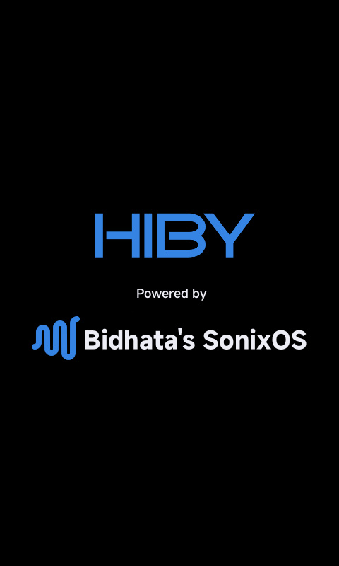
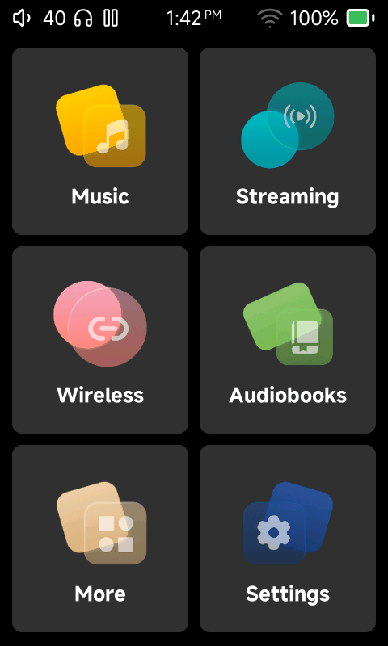
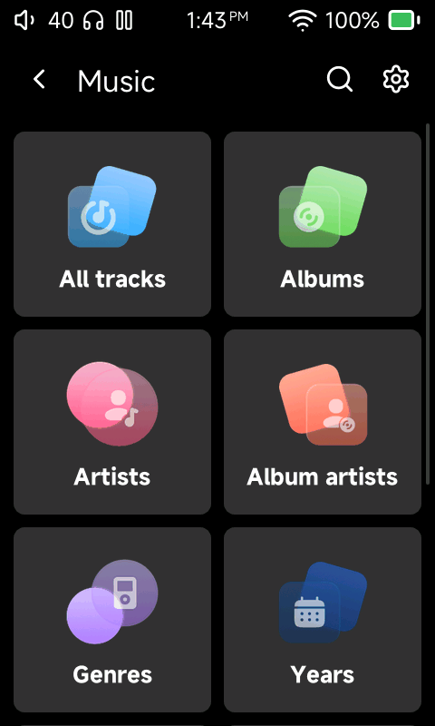
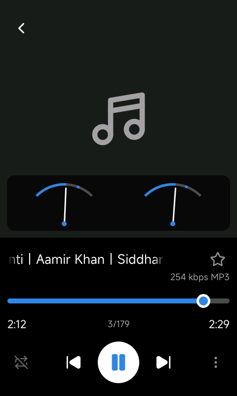
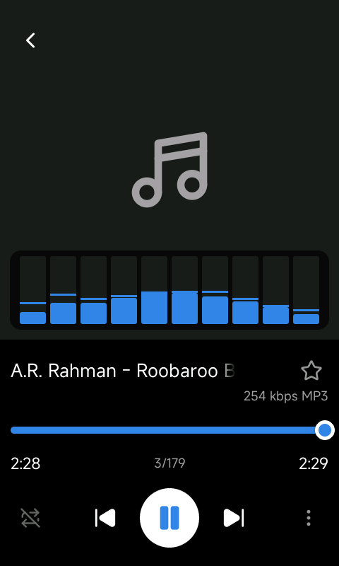
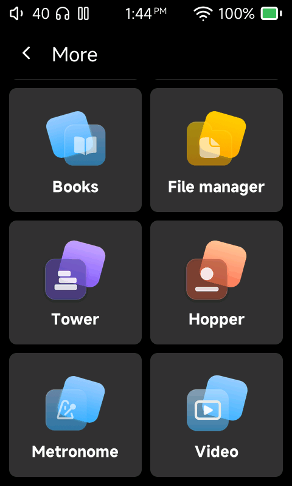
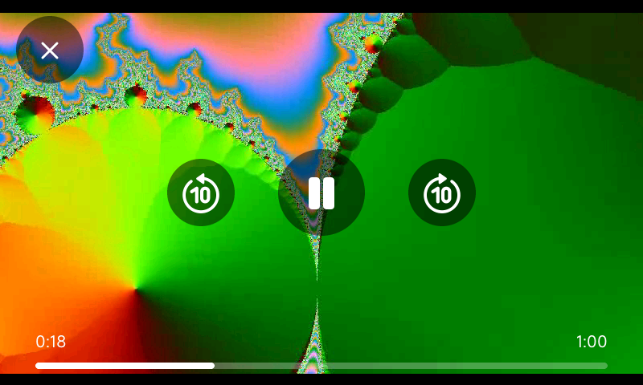
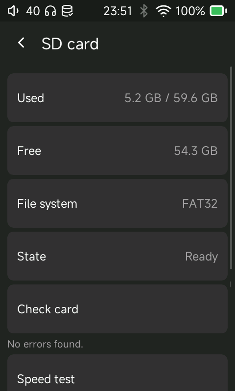

<div align="center">



# Bidhata's SonixOS

**Your HiBy R1 and R3 Pro II, rebuilt from the ground up.**

Open-source firmware that turns a pocket music player into the one you wished it shipped as:<br>
every format, real streaming, video, a VU meter that moves with the music, and nothing you cannot change.

[](LICENSE)


[**Features**](FEATURES.md) · [**Install**](#install) · [**What is new here**](#what-this-fork-adds) · [**Build it**](#build-it-yourself) · [**Video guide**](VIDEO.md)

</div>

> [!WARNING]
> **Tested on the HiBy R1 only.** The R3 Pro II images are built from the same source but have **never been run on a device** by this fork. A firmware that does not start leaves the player restarting in a loop, so if you flash one, have HiBy's stock `r3proii.upt` ready on a card to go back. Reports from R3 Pro II owners are very welcome.

---

<div align="center">





</div>

## A closer look

<table>
<tr>
<td colspan="2" align="center">
<br>
<b>Video player.</b> A film playing on a HiBy R1, held sideways: pause, 10-second skips, a seek bar to drag, elapsed and total time.
</td>
</tr>
<tr>
<td width="50%" align="center" valign="top">
<br>
<b>VU dials.</b> Two needles and a held peak mark over the cover. Tap for bars or a ten-band spectrum.
</td>
<td width="50%" align="center" valign="top">
<br>
<b>SD card.</b> File system, a warning when the card was pulled out unsafely, a speed test with its result, and Format.
</td>
</tr>
</table>

## Why

The HiBy R1 costs less than a pair of decent earphones and has a good DAC in it. The software it ships with does not do it justice. Bidhata's SonixOS replaces the whole player: the interface, the audio chain, the Bluetooth stack, even the drivers. One binary, written in C on LVGL, runs on both players.

It is a fork of [Sonix Player](https://github.com/Tartarus6/sonix-player) by Tartarus6, itself the successor to M4ttia's Sonix. Everything good underneath is theirs. This fork adds the things below.

## What this fork adds

| | |
|---|---|
| 🎬 **Video player** | MPEG-4 and H.264 films from the card, full screen and turned sideways, with a seek bar you can drag, resume where you left off, and sound over Bluetooth. A [script](VIDEO.md) converts anything for the screen. |
| 📊 **VU meter, three ways** | Two bars, two needle dials or a ten-band spectrum on Now Playing. Tap to switch. It follows the sound you hear, not the sound just sent to the output. |
| 🔑 **Bring your own API keys** | No keys in the firmware? Drop a `streaming-keys.ini` on the card and Last.fm and the podcast catalogue come alive. |
| 📱 **Last.fm by QR code** | Scan, approve on your phone, done. No password typed on a tiny screen. |
| ⏱️ **Track lengths everywhere** | In every list, in search, and as an album's running time. |
| 🌙 **Auto sleep timer** | A nightly window in which playback stops by itself. |
| ⏪ **Jump back and forward** | On remapped buttons and on the wired remote. |
| 💾 **SD card page** | How full, what format, whether it was pulled out unsafely, a speed test that verifies what it reads back, and Format. |
| 🛠️ **A full audit** | Fixes across audio, decoders, the library, streaming, Bluetooth, USB and power. |

Upstream's own additions are merged too: SACD ISO playback, a custom accent colour picker, and Hebrew text.

## Everything it does

The short version: it plays every format worth owning, streams, reads you books, shows you films, and lets you change almost all of it. The long version follows. The same list, kept current feature by feature, is in **[FEATURES.md](FEATURES.md)**: if something is not there, the player does not do it yet.

### 🎵 Plays what you have

| | |
|---|---|
| **Formats** | `.flac` `.mp3` `.wav` `.aif` `.aiff` `.m4a` `.aac` `.ogg` `.opus` `.wv` `.ape` `.caf` `.dsf` `.dff` and SACD `.iso` images |
| **DSD** | Played natively, or converted to PCM when the output cannot take it, as over Bluetooth |
| **SACD ISO** | The stereo area becomes an album, one track per SACD track, with the image's own titles. DSD and DST both play |
| **CUE sheets** | A whole disc in one file with a `.cue` beside it shows up as separate tracks |
| **Gapless and fade** | No silence between the tracks of an album, also over Bluetooth. Or fade one into the next, 1 to 12 seconds |
| **ReplayGain** | Off, by track or by album, read from the tags |
| **Playback modes** | Normal, repeat all, repeat one, shuffle, and a continuous shuffle that deals a new order every round |
| **Queue** | Reorder it, add next or at the end, and look back at what you played today, yesterday and before |
| **Remember track** | The queue and the position are still there after a restart |
| **Sleep timers** | One each for music, audiobooks and podcasts, plus a nightly window that starts them by itself |

### 📚 A library that keeps up

- **Ten ways in**: All tracks, Albums, Artists, Album artists, Genres, Years, Favourites, Most played, Playlists and Browse. Rearrange the tiles, hide the ones you never use.
- **Search** across tracks, albums and artists, an **A-Z bar** on long lists, and sorting that works in every alphabet and skips a leading "The".
- **Track lengths** on every row and in search, and an album's total running time.
- **Split artists and genres**: "A & B" and "A feat. B" appear under both names, with a list of names that must never be split.
- **Detect changes**: new music is picked up when the player starts, when the card goes back in, and after USB or Wi-Fi transfer.
- **Quality badges** under each title: lossy, CD, Hi-Res or DSD.
- **Playlists** you can create, reorder, back up as `.m3u` and import again, even after files have moved.
- **Cover Flow**: swipe up from the bottom of the Music page and flip through your albums.
- **Select many**: long-press, pick more, then queue them, favourite them or put them in a playlist.

### 🎚️ Now Playing

- **Three layouts**: Standard, Waveform (the progress bar is the waveform of the track) and Alternative.
- **VU meter in three shapes**: two bars with a peak-hold tick, two needle dials, or a ten-band spectrum from 31 Hz to 16 kHz. Tap the meter to change shape. It is on a dB scale and follows the sound as it is heard, not as it is handed to the output.
- **Cover colour**: the buttons and the bar take the main colour of the artwork.
- **Lyrics**: swipe on the cover. Synced lyrics follow line by line, from a `.lrc` file, from the tags, or downloaded from LRCLIB.
- **Details** for every track: length, format, bitrate, size, ReplayGain and more.

### 🎛️ Sound, shaped your way

| | |
|---|---|
| **Graphic EQ** | 10 bands, ±12 dB, 10 presets and as many of your own as you like |
| **Parametric EQ** | 10 bands with frequency, gain, Q and shape (peak, shelves, low and high pass), a preamp, and a graph of the real curve. Presets are Equalizer APO `.txt` files |
| **AutoEq** | Type the name of your headphones and the player downloads their correction |
| **MSEB** | The stock HiBy tuning, all 10 sliders |
| **Stage** | Soundfield (narrower down to mono, or wider), crossfeed, channel balance, mono |
| **DAC** | 4 digital filters, NOS, high gain, DSD gain compensation, and DRE on the R3 Pro II |
| **Everywhere** | EQ, PEQ and MSEB also work on radio and streaming |

### 🔊 Volume and outputs

- **One volume per output**, remembered: 3.5 mm, 4.4 mm balanced, USB-C and Bluetooth. A **volume limit** for each, and your choice of step size.
- **Line out**: a fixed level for an amplifier, with your own volume back when you turn it off.
- **USB DAC**: plug the player into a computer and it is the computer's sound card, 32 kHz to 384 kHz.
- **USB audio out**: plug a USB DAC or USB-C headphones into the player.

### 📡 Streaming and radio

- **Tidal**: Low, High, CD and Hi-Res. Search, albums, artists, playlists, favourites, new releases and recommendations, with favourites and playlists managed from the player.
- **Qobuz**: MP3 320 up to FLAC 24/192. Search, albums, artists, playlists, favourites and new releases.
- **Radio**: thousands of stations by country, language or genre, with search, favourites and your own list in a `radio.txt`.
- **Last.fm**: scrobbles what you play and keeps the plays until Wi-Fi is back. Sign in by scanning a QR code.
- **Bring your own API keys**: the four services above need application keys, and [you can supply your own](#streaming-keys).

### 🎙️ Podcasts, audiobooks and books

- **Podcasts**: search and Trending from Podcast Index, follow up to 100 shows, download episodes for the road, continue where you stopped, mark heard, change speed, and import or export OPML. Podcasts you put on the card yourself are played too.
- **Audiobooks**: one file or a whole folder, chapters, a position remembered per book, 0.5x to 2.0x speed without changing the pitch, rewind after pause, stop at the end of the chapter, and bookmarks.
- **E-books**: EPUB 2 and 3 with covers and pictures, three reading themes, three page-turn animations, your choice of text size and spacing, and vertical text for Japanese books.

### 🎬 Video, games and extras

- **Video player**: MPEG-4 and H.264 films from the card's `Video` folder, full screen and turned sideways, with pause, 10-second skips, a seek bar you can drag, elapsed and total time, and resume where you left off. Sound on the socket or over Bluetooth. Films are [converted on a computer first](#converting-a-video).
- **Game Boy**: Game Boy and Game Boy Color games through Gearboy, with save states, five palettes, shaders and colour correction.
- **File manager**: browse, create, rename, move, copy and delete. Pictures, text files and videos open right there.
- **Metronome** with tap tempo, and **Flappy Bird**, because why not.

### 📶 Wireless

| | |
|---|---|
| **Bluetooth out** | SBC, AAC, aptX, aptX-HD and LDAC, the best one chosen by itself. Volume synced with the headphones |
| **AirPods** | Battery for each earbud and the case, and noise control from the player |
| **Bluetooth receiver** | A phone plays through the player as if it were a speaker |
| **AirPlay** | Play from an iPhone, iPad or Mac |
| **DLNA** | Send music to the player from an app on your phone |
| **Wi-Fi transfer** | Open the address on screen in a browser and manage the card's files from there |
| **SonixLink** | Control the player from the SonixLink phone app, over Wi-Fi or Bluetooth |
| **USB storage** | Plug in the cable and the card shows up as a drive |

### 🎨 Make it yours

- **Dark and light themes**, six accent colours or **any colour** from a picker, and a dynamic tint that colours the whole interface.
- **Boot logo** and **screensaver** from your own pictures.
- **Control centre**: pull down from the status bar for brightness and a row of switches you choose and order yourself.
- **Remap every button**, add double-click actions, and jump back or forward inside a track from the wired remote.
- **Twelve interface languages**, eleven keyboard layouts including a T9 keypad and Japanese kana input.
- Text size, rounded corners, where the clock sits, 180° rotation, double tap to wake on the R3 Pro II.

### 🔋 Power and care

- **Charge limit** to make the battery last: 80% on the R1, 80% to 100% on the R3 Pro II.
- **Standby** and **auto power-off**, from 15 minutes to 48 hours.
- **SD card page**: how full the card is, what it is formatted as, whether it was pulled out without being unmounted, a speed test that checks what it reads back, and **Format** (FAT32, after asking twice).
- **Firmware update** from the card or over the internet.
- **Developer options**: ADB, logs to the card, and a process and memory view.

## Install

> [!CAUTION]
> **Flash only the file for your player.** `r1.upt` is for the R1, `r3proii.upt` for the R3 Pro II. The update system does not check, and the wrong one will not boot.

1. Get the image for your player from the **[releases page](https://github.com/bidhata/bidhata-sonix-h1/releases)**, or [build it yourself](#build-it-yourself).
2. Charge the player **above 30%**.
3. Copy the `.upt` file to the **root of the microSD card** and put the card in the player.
4. Start the update:
   - from the stock firmware: its own firmware update from the microSD card;
   - from SonixOS: Settings > System > Update firmware > From SD card.
5. It says "Upgrading...", then "Succeeded", and restarts by itself.

Going back is the same steps with HiBy's original firmware.

> [!WARNING]
> **The R3 Pro II image is untested.** Every build here has been flashed and used on a **HiBy R1**. The `r3proii.upt` files are produced by the same build but nobody on this fork has started one on an R3 Pro II. Before you try it: charge the player, keep HiBy's stock firmware on a card, and expect that you may need it. If it works, or if it does not, please [open an issue](https://github.com/bidhata/bidhata-sonix-h1/issues/new/choose) and say so.

Builds tagged `build-...` on the releases page are made automatically from the latest source and are pre-releases: nobody has run them at all.

## Streaming keys

Tidal, Qobuz, the podcast catalogue and Last.fm each need application keys, and this repository does not carry any. A build without them simply leaves those four switched off; everything else works.

To switch one on with keys of your own, put a text file named `streaming-keys.ini` in the **root folder of the card** and restart the player:

```ini
[lastfm]
api_key = ...
api_secret = ...

[podcast]
api_key = ...
api_secret = ...
```

Last.fm gives keys to anyone with an API account ([last.fm/api](https://www.last.fm/api)), and so does [Podcast Index](https://podcastindex.org). Tidal and Qobuz do not issue keys to individuals. The file is plain text, so anyone holding the card can read it.

## Converting a video

The players have one small processor core and no video hardware, so films are converted on a computer first. One line does it:

```bash
sonix-player/tools/video-convert.sh "My Film.mkv"     # writes My Film.r1.mp4
```

Copy the result into a folder called `Video` on the card, and open **More > Video**. The details, and the same conversion as a plain `ffmpeg` command, are in **[VIDEO.md](VIDEO.md)**.

## Build it yourself

```bash
cd sonix-player
make host -j$(nproc)      # the simulator, on your desktop
make target -j$(nproc)    # the player, for the device
```

The first `make target` builds its own cross toolchain, so it takes a while. To turn the result into a flashable image, put HiBy's stock firmware next to `sonix-packer/sonix_firmware_packer.sh` and run it.

The full guide, with what to install, the simulator's options, the packer, the kernel and the source tree, is in **[readme-old.md](readme-old.md)**.

## Contributing

Bug reports and feature requests go through the [issue forms](https://github.com/bidhata/bidhata-sonix-h1/issues/new/choose). For a bug, turn on Settings > Developer options > Log to microSD first and attach the log.

Pull requests are welcome: one thing per request, tested on a real player where you can, and with `FEATURES.md` updated when a feature changes. The checklist is in the [pull request template](.github/pull_request_template.md).

## Credits

- **[Tartarus6](https://github.com/Tartarus6)** for Sonix Player and the [custom kernel](https://github.com/Tartarus6/hiby-custom-kernel) this runs on.
- **Jepl4r / M4ttia**, who started Sonix.
- [@noisetta](https://github.com/noisetta), [@endgame47](https://github.com/endgame47), [@hkhrithik007](https://github.com/hkhrithik007) and everyone who has sent a fix upstream.
- [LVGL](https://lvgl.io), [FFmpeg](https://ffmpeg.org), [Gearboy](https://github.com/drhelius/Gearboy), [BlueALSA](https://github.com/arkq/bluez-alsa), and the authors of the decoders in `src/system/decode`.

Not affiliated with HiBy. HiBy is a trademark of its owner.

## License

[GPL-3.0](LICENSE). Use it, change it, share it, and keep it open.

<div align="center">

**If this made your player better, a ⭐ helps other owners find it.**

</div>
